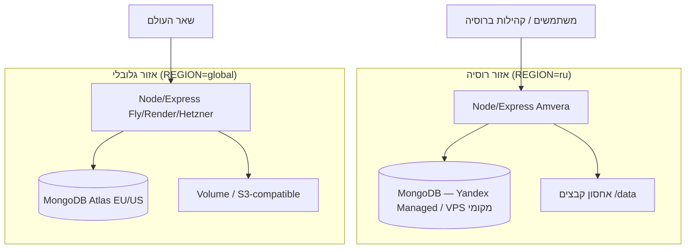

# תוכנית פריסה גלובלית: רוסיה מול שאר העולם

מסמך תכנון לפלטפורמת לוח הזיכרון (Kaddish Memorial Board SaaS) — שני אזורי שירות, עמידה ב-152-FZ, תשלומים, תלויות חיצוניות וגלגול הדרגתי.

---

## 1. מטרה ועקרונות

| עקרון | פירוט |
|--------|--------|
| **קוד אחד** | מאגר Git יחיד; התנהגות נקבעת ב-`REGION` (למשל `ru` / `global`) ומשתני סביבה. |
| **שני פריסות** | **רוסיה** — Amvera / תשתית רוסית; **גלובלי** — Fly.io, Render, Hetzner EU וכד'. |
| **נתונים אישיים** | לפי חוק הפדרציה הרוסי **152-FZ**: איסוף/אחסון ראשוני של נתונים אישיים של אזרחי רוסיה — **בתחום רוסיה**. |
| **חוויית משתמש** | אותה אפליקציה; בחירת אזור בהפעלה ראשונה (אפליקציית Android) או ניתוב לפי slug/דומיין. |

---

## 2. ארכיטקטורה מוצעת



### מסד נתונים: משותף או נפרד?

| אפשרות | יתרונות | חסרונות |
|--------|---------|---------|
| **שני clusters נפרדים (מומלץ)** | עמידה ב-152-FZ; אין תלות בקישוריות Atlas מרוסיה; בידוד תקלות | שכפול תחזוקה; אין slug אחד על שני האזורים בלי סינכרון |
| **Atlas אחד + replica** | ניהול פשוט | גישה מרוסיה ל-Atlas לא יציבה/חסומה; מיקום נתונים רוסיים מחוץ לרוסיה — סיכון משפטי |
| **Yandex Managed MongoDB (RU) + Atlas (GL)** | כל אזור במיקום נכון | מיגרציה נפרדת; גיבויים כפולים |

**המלצה:** שני מסדי נתונים עצמאיים; כל קהילה (`slug`) שייכת ל**אזור אחד בלבד**. Master admin יכול לנהל רשימת קהילות לפי אזור (או שני ממשקי master נפרדים עם אותו קוד).

### דומיינים

| אזור | דוגמה |
|------|--------|
| רוסיה | `kaddish.ru`, `*.kaddish.ru`, או תת-דומיין על Amvera |
| גלובלי | `kaddish.app`, `memorial.example.org` |

ניתוב: DNS גיאו (אופציונלי) או **קישור מפורש** בחומרי שיווק / onboarding לפי מדינה.

### תשלומים

| אזור | ספקים |
|------|--------|
| רוסיה | **YooKassa**, כרטיסי מיר/Visa/MC רוסיים, חשבונית מקומית |
| גלובלי | **Stripe** (או Paddle) |

בקוד: מודול `lib/billing` עם `BILLING_PROVIDER=yookassa|stripe` לפי `REGION` (עדיין לא קיים במוצר — שלב עתידי).

---

## 3. תלויות חיצוניות בקוד (בדיקה במאגר)

### שרת (Node.js)

| שירות | שימוש בקוד | סיכון ברוסיה | מיטיגציה |
|--------|------------|--------------|------------|
| **MongoDB Atlas** | `MONGODB_URI` | חיבור לא אמין | Yandex Managed MongoDB / Mongo על VPS ברוסיה |
| **Google Fonts** | `views/layouts/admin.handlebars`, `master`, `onboarding`, `login` | חסימה/האטה | גופנים self-host ב-`/css/fonts` |
| **Bootstrap / jQuery CDN** | `admin.handlebars` | בינוני | vendor מקומי ב-`public/vendor` |
| **unpkg Leaflet** | onboarding/master layouts + JS | בינוני | חבילה מקומית |
| **stackpath.bootstrapcdn.com** | master layout | בינוני | self-host |
| **Nominatim (OpenStreetMap)** | `routes/master.js`, `routes/onboarding.js` | עומס/מגבלות | proxy פנימי + cache; או Yandex Geocoder ל-RU |
| **translate.googleapis.com** | `routes/admin.js` (תרגום אוטומטי) | חסימה | DeepL API EU / מודל מקומי / כיבוי ב-RU |
| **OpenRouter** | `lib/grave-ocr.js` (סריקת מצבות) | חסימה | DeepSeek/Gemini ישיר (אם זמין) / OCR מקומי / כיבוי תכונה |
| **Google Generative Language API** | `grave-ocr.js` (provider gemini) | חסימה | כמו OpenRouter |
| **DeepSeek API** | `grave-ocr.js` | לבדוק | proxy או ספק מקומי |
| **Hebcal (www.hebcal.com)** | `lib/jewish-feed.js`, לוח (npm `hebcal` מקומי) | API חיצוני עלול להיחסם | חישוב מקומי ב-`hebcal` npm; cache ל-feed |
| **api.open-meteo.com** | `lib/weather-api.js`, אפליקציית Android | בדרך כלל עובד | Yandex Weather ל-RU אופציונלי |
| **OpenStreetMap tiles** | `onboarding-wizard.js`, `master-dashboard.js` | בינוני | tiles מקומיים או MapTiler עם מפתח |
| **TorahCalc / Sefaria** | `lib/jewish-feed.js` | בינוני | cache ארוך; כיבוי פיצ'ר ב-RU |
| **MyMemory Translation** | `lib/hayom-yom-store.js` | בינוני | תרגום מראש / ללא תרגום אוטומטי |
| **lchaimweekly.org** | `lib/lchaim-scraper.js` | נמוך | cache |
| **Google Drive** | `lib/migrate-photos-drive.js`, provisioning | חסימה | העלאה ישירה לשרת בלבד ב-RU |
| **html2canvas (jsdelivr)** | `admin-settings-panel.js`, `admin-tile-capture.js` | בינוני | bundle מקומי |
| **wa.me / t.me** | `lib/contact-links.js`, weekly kaddish | בדרך כלל OK | — |
| **Nodemailer (SMTP)** | תזכורות יארצייט | תלוי בספק SMTP | SMTP רוסי (Yandex/Mail.ru) ב-RU |
| **placeholder photos** | `lib/placeholder-photo.js` (seed) | לא לפרודקשן | לא להפעיל ב-RU |

### לוח זיכרון (React / Vite)

| שירות | שימוש | הערה |
|--------|--------|------|
| **hebcal** (npm) | תאריכים עבריים, פרשה | מקומי — מועדף |
| **Hebcal Shabbat API** | `client/src/lib/shabbat-times.js` | להחליף בחישוב מקומי או proxy |
| **GitHub Pages** | `npm run build:pages` | סטטי לדמו; לא לנתונים אישיים |

### אפליקציית Android (`sidebar-android-app`)

| שירות | קובץ | הערה |
|--------|------|------|
| שרת ברירת מחדל Amvera | `settings.js` | שני `BASE_URL` לפי אזור |
| Open-Meteo, Hebcal | `weather.js`, `offline-feed.js` | כמו שרת |

---

## 4. משתני סביבה מוצעים

```bash
REGION=ru|global
PUBLIC_BASE_URL=https://...
MONGODB_URI=...
# אופציונלי:
BILLING_PROVIDER=yookassa|stripe
GRAVE_OCR_ENABLED=false   # ב-RU עד שיש נתיב מקומי
JEWISH_FEED_REMOTE=false  # רק hebcal מקומי + cache
```

CI: workflow כפול — deploy `ru` על push ל-`main` עם secrets של Amvera; deploy `global` ל-Fly/Render.

---

## 5. אפליקציית Android — בחירת אזור

1. **הפעלה ראשונה:** מסך «איפה הקהילה שלך?» → רוסיה / שאר העולם (או זיהוי אוטומטי עם אפשרות לשנות).
2. **שמירה:** `serverUrl` מוגדר ל-BASE של האזור; אופציונלי — הזנת slug מנתבת ל-`/s/{slug}/...`.
3. **רשימת URLs:**  
   - `RU_API_BASE` (Amvera)  
   - `GLOBAL_API_BASE` (Fly וכו')
4. עדכון גרסה: שני ערוצי APK או APK אחד עם בחירת אזור (מומלץ APK אחד).

---

## 6. עלויות חודשיות משוערות (סדר גודל)

| רכיב | רוסיה (Amvera + Yandex DB) | גלובלי (Fly/Render + Atlas) |
|------|----------------------------|-----------------------------|
| אפליקציה | ~$15–40 | ~$20–50 |
| MongoDB | ~$30–80 (Managed) | ~$25–70 (Atlas M10) |
| אחסון תמונות | כלול / volume | volume / R2 ~$5 |
| דומיין + SSL | ~$3–10 | ~$10–20 |
| OCR (OpenRouter) | $0 אם כבוי | ~$5–50 לפי שימוש |
| **סה״כ התחלתי** | **~$50–130** | **~$60–150** |

לא כולל תשלומים ללקוחות (Stripe/YooKassa עמלות), תמיכה, גיבויים off-site.

---

## 7. סיכונים

| סיכון | הפחתה |
|--------|--------|
| הפרדת קהילות בין אזורים בטעות | שדה `region` במסמך Synagogue; בדיקה ב-onboarding |
| slug כפול בשני אזורים | רישום master גלובלי או namespace (`ru-novosibirsk`) |
| תלות CDN זר ב-admin | שלב 1: self-host גופנים ו-Bootstrap |
| 152-FZ / ביקורת | ייעוץ משפטי מקומי; DPA עם ספקי RU |
| סנכרון קוד בין אזורים | CI אחד, שני deploy targets |
| גיבוי | גיבוי יומי per-region; שחזור נבדק |

---

## 8. גלגול הדרגתי (phased rollout)

### שלב 0 — הכנה (1–2 שבועות)
- [ ] הוספת `REGION` ו-`PUBLIC_BASE_URL` לקונפיג (ללא שינוי UX).
- [ ] תיעוד env ל-Amvera ול-Fly.
- [ ] self-host Google Fonts + Bootstrap ל-admin/master.

### שלב 1 — פריסה כפולה, קהילות קיימות (2–4 שבועות)
- [ ] MongoDB ברוסיה; מיגרציה של קהילות רוסיות מ-Atlas (אם רלוונטי).
- [ ] פריסת `REGION=ru` על Amvera (כבר קיים חלקית).
- [ ] פריסת `REGION=global` על Fly/Hetzner; קהילות לא-רוסיות חדשות רק שם.
- [ ] כיבוי `translate.googleapis.com` ב-RU או proxy.

### שלב 2 — מוצר ותשלומים (4–8 שבועות)
- [ ] YooKassa ב-RU; Stripe ב-global.
- [ ] מסך onboarding: בחירת אזור / קישור לדומיין הנכון.
- [ ] Android: בחירת אזור + שני BASE URLs.

### שלב 3 — תלויות ותכונות (מתמשך)
- [ ] Jewish feed: cache + מצב offline מלא ב-RU.
- [ ] Grave scan: ספק OCR מותאם אזור או off ב-RU.
- [ ] ניטור (uptime) per region.

### שלב 4 — אופטימיזציה
- [ ] CDN לתמונות static per region.
- [ ] DR drill אחת לרבעון לכל אזור.

---

## 9. סיכום טכני לצוות

- **אין צורך בפיצול מאגרים** — רק פריסה, secrets ו-DB נפרדים.
- **קהילה = tenant אחד באזור אחד** — זה מפשט משפטית ותפעולית.
- **תלויות הקריטיות ברוסיה:** Google (fonts, translate, generative), OpenRouter, Drive, Atlas — כולן דורשות תחליף, proxy או כיבוי מבוקר.
- **תלויות שכבר מקומיות:** `hebcal` npm, `sharp`, רוב לוגיקת הלוח — ממשיכים לעבוד על שרת רוסי.

---

*נוצר מתוך סריקת הקוד ב-worktree; לעדכון לפני יישום משפטי/תשתיתי.*
